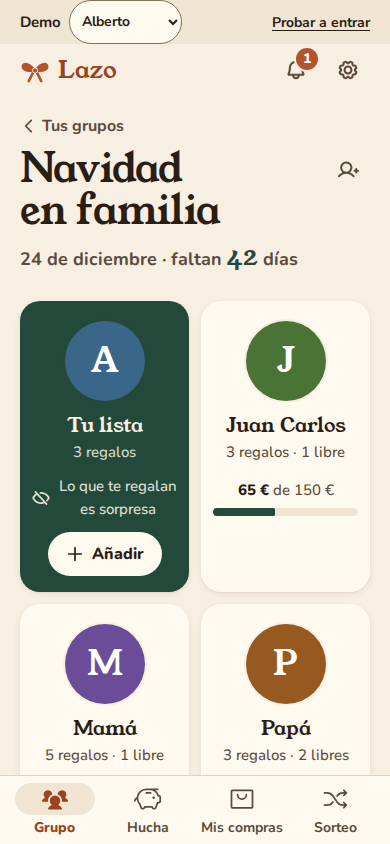
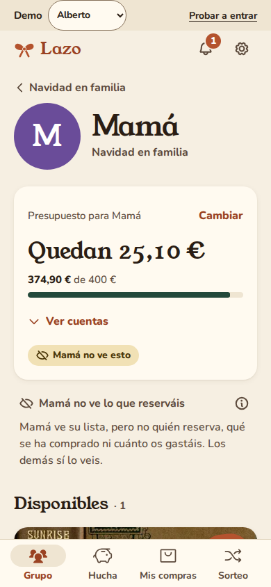
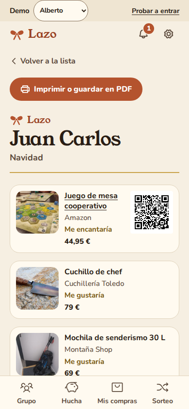
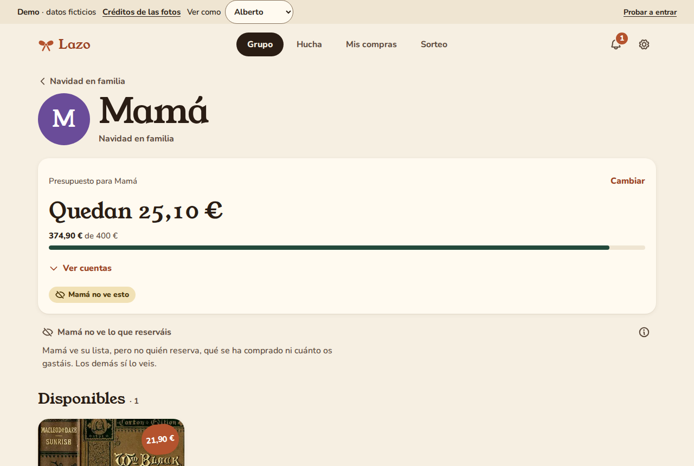

  

<h1 align="center">Lazo</h1>

<strong>Listas de regalos en familia. Sin regalos repetidos, sin spoilers.</strong>

  <a href="https://bertmarti.github.io/lazo/"><b>Probar la demo</b></a> ·
  <a href="#cómo-funciona">Cómo funciona</a> ·
  <a href="#instalarlo-en-casa">Instalarlo en casa</a> ·
  <a href="CHANGELOG.md">Novedades</a>

  
  
  

---

Cada Navidad pasa lo mismo: dos bufandas iguales para el abuelo, nadie sabe qué quiere la sobrina y alguien acaba preguntando en el grupo de WhatsApp «¿qué le habéis comprado a mamá?» con mamá leyendo.

**Lazo lo arregla con una regla muy sencilla:** ves qué está libre, reservado o comprado en las listas de los demás, **pero nunca en la tuya**. Ni en la pantalla ni por detrás: el servidor no se lo envía a tu móvil.

  
  &nbsp;
  
  &nbsp;
  

  

## Qué puedes hacer

- **Una lista para cada uno.** Pega un enlace de **Amazon** o de **cualquier tienda** y Lazo rellena el nombre, la foto y el precio. También puedes **subir un Excel** con tu lista o escribirla a mano, con talla, color y cuántas ganas tienes de cada cosa.
- **Sorpresa garantizada.** En las listas de los demás ves qué está libre, quién lo ha reservado y quién lo ha comprado. En la tuya, nada.
- **Un presupuesto para cada uno.** «124,90 € de 200,00 €. Quedan 75,10 €.» Lo ve toda la familia… menos el destinatario.
- **Reservar es un toque.** Y si te equivocas, «Deshacer».
- **Regalos a medias.** Para el regalo caro de los abuelos, cada uno apunta lo que pone, Lazo te dice cuánto falta y quién debe qué a quién cuando alguien lo compra.
- **Amigo invisible.** Un sorteo con exclusiones (que las parejas no se toquen entre sí). Cada persona solo ve su sobre; ni quien organiza ve los demás.
- **Listas de niños.** Los peques no necesitan cuenta: su lista la llevan sus padres, que sí ven lo reservado para coordinarse.
- **Avisos sin chivatazos.** Una campana te cuenta lo nuevo del grupo («Papá ha añadido 3 regalos», «faltan 10 días») y nunca dice nada de tu propia lista.
- **En tu casa.** Guía paso a paso para montarlo en una Raspberry o un mini PC con copias de seguridad, HTTPS y acceso desde fuera para la familia: [docs/HOMELAB.md](docs/HOMELAB.md).
- **Entrar sin contraseñas.** Te llega un enlace por WhatsApp, escribes tu nombre y ya estás dentro.
- **Mis compras.** Todo lo que has reservado o comprado y cuánto llevas gastado, en una sola pantalla.

## Cómo funciona

1. Alguien crea un grupo («Navidad en casa de la abuela») y comparte el enlace por WhatsApp.
2. Cada persona entra con su nombre y apunta lo que le gustaría.
3. Los demás abren su lista, **reservan** lo que van a regalar y lo marcan como **comprado** cuando lo tienen.
4. Nadie repite y nadie se entera de lo suyo hasta el día.

> **¿Por qué no veo si me han reservado algo?** Porque es la gracia. Lazo está hecho para que sea imposible, incluso para quien sepa programar.

## Probar la demo

**[bertmarti.github.io/lazo](https://bertmarti.github.io/lazo/)**

Es una familia de cinco con datos inventados: Alberto, Juan Carlos, Samira, Mamá y Papá. Arriba tienes **«Ver como…»**: cambia a Mamá y comprueba que no ve que Alberto le ha reservado el marco de fotos ni cuánto os gastáis en ella; cambia a Samira y lo verás todo. Todo se guarda en tu navegador; no hay servidor detrás.

## Instalarlo en casa

Lazo necesita un pequeño servidor para que la familia comparta las listas. Está pensado para un **Raspberry Pi** o cualquier ordenador de casa con Docker, igual que [SHIELD-DNS](https://github.com/BertMarti/SHIELD-DNS) y [HEIMDALL](https://github.com/BertMarti/HEIMDALL). La guía paso a paso está en [docs/HOMELAB.md](docs/HOMELAB.md).

- **En el móvil:** abre tu Lazo en el navegador y pulsa «Añadir a pantalla de inicio». También hay **APK de Android** en las [Releases](https://github.com/BertMarti/lazo/releases).
- **Coste:** cero. Ni cuotas ni anuncios.

## Modelos y su función

La IA es **opcional** y está **apagada por defecto**: Lazo funciona entero sin ella.

| Motor | Para qué | Cuándo elegirlo |
|---|---|---|
| **Sin IA** | Columnas de Excel por sinónimos y ajuste a mano; ideas de un catálogo por edades | Siempre disponible |
| **Ollama** (en tu casa) | Entender Excel raros y sugerir ideas por edad, gustos y presupuesto | Lo recomendado: gratis y nada sale de tu red |
| **Claude** o **Gemini de pago** | Lo mismo, con tu clave | Si no tienes Ollama |
| Groq, OpenRouter, NVIDIA y la capa gratuita de Gemini | Lo mismo | Solo para probar: sus condiciones no encajan con el uso diario en la UE ([detalles](docs/legal/proveedores.md)) |

La clave de la IA se queda en tu dispositivo: el servidor de Lazo nunca la ve. A la IA nunca le llega el nombre de un niño ni su año de nacimiento, solo una franja de edad («6–8 años»).

## Privacidad y legal

- Tus listas viven en **tu** servidor, no en el de una empresa.
- Para los niños, solo el nombre de pila y, si quieres, el año en que nacieron.
- Al pegar un enlace, el servidor solo lee los datos públicos que la tienda publica para compartir (los mismos que usa WhatsApp para la vista previa).

En lenguaje llano: [privacidad](docs/legal/PRIVACIDAD.md), [datos de los niños](docs/legal/MENORES.md) y [términos de uso](docs/legal/TERMINOS.md). La parte técnica está en [SECURITY.md](SECURITY.md).

## Para quien quiera colaborar

[CONTRIBUTING.md](CONTRIBUTING.md) · [AGENTS.md](AGENTS.md) · [diseño](docs/superpowers/specs/2026-11-11-lazo-design.md) · licencia [MIT](LICENSE)

Hecho con cariño para las familias que se lían con los regalos.

