

  

<h1 align="center">Lazo</h1>

  <strong>Las listas de regalos de tu familia, en el móvil.</strong> 
  Cada uno apunta lo que le gustaría y los demás reservan lo que van a regalar. 
  Nadie repite regalo y nadie ve lo que le van a regalar a él: la sorpresa está garantizada.

  <a href="https://bertmarti.github.io/lazo/"><b>▶ Probar la demo</b></a>
  &nbsp;·&nbsp;
  <a href="https://github.com/BertMarti/lazo/releases/latest"><b>Descargar para Android</b></a>
  &nbsp;·&nbsp;
  <a href="docs/PRUEBA-REAL.md"><b>Montarlo en casa</b></a>

---

Cada Navidad pasa lo mismo: dos bufandas iguales para el abuelo, nadie sabe qué quiere la sobrina y alguien pregunta en el grupo de WhatsApp «¿qué le habéis comprado a Marta?» con Marta leyendo. Lazo lo arregla con una regla muy sencilla: **en las listas de los demás ves qué está libre, reservado o comprado; en la tuya, nada.**

**En esta guía:** [1. Crear el grupo](#1-crear-el-grupo) · [2. Invitar a la familia](#2-invitar-a-la-familia) · [3. Entrar por el enlace](#3-entrar-por-el-enlace) · [4. Añadir regalos](#4-añadir-regalos) · [5. Reservar, comprar y la hucha](#5-reservar-comprar-y-la-hucha) · [6. La regla de la sorpresa](#6-la-regla-de-la-sorpresa) · [7. El amigo invisible](#7-el-amigo-invisible) · [8. El día de la entrega](#8-el-día-de-la-entrega) · [9. Imprimir y compartir tu lista](#9-imprimir-y-compartir-tu-lista) · [Preguntas frecuentes](#preguntas-frecuentes)

> **¿Quieres verlo antes de nada?** En la [demo](https://bertmarti.github.io/lazo/) hay una familia inventada: Alberto, Javier, Samira, Marta y Papá. Arriba, en **«Ver como»**, cambias de persona y ves la app como la ve cada uno. Todo se queda en tu navegador.

## 1. Crear el grupo

Un grupo es una ocasión: «Navidad en familia», «Cumpleaños de Papá», una boda… En **Tus grupos**, toca **«Crear grupo»** (o **«Crear otro grupo»** si ya tienes uno) y rellena:

- **Nombre** y **ocasión**.
- **Fecha**, para la cuenta atrás («faltan 99 días»). Puedes dejarla vacía.
- **¿Cómo compráis?** *Hucha común* (ponéis dinero entre todos), *Cada uno lo suyo* (cada regalo lo paga quien lo reserva) o *Mixto* (se decide regalo a regalo).
- **¿Quiénes sois?** Un nombre por línea. Cada uno tendrá su sitio aunque aún no haya entrado.

  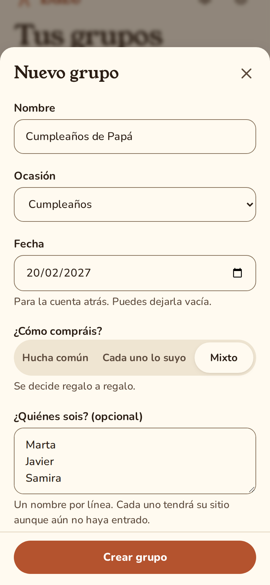
  &nbsp;
  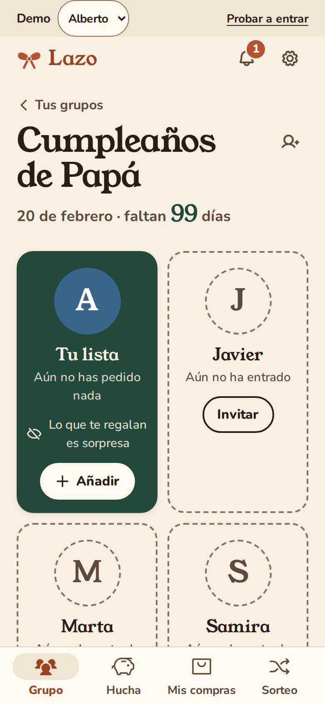

## 2. Invitar a la familia

Toca el icono de **«Invitar a la familia»**, arriba a la derecha del grupo (o **«Invitar»** en la tarjeta de alguien que aún no ha entrado).

- **«Enviar enlace»** junto a cada nombre: abre WhatsApp con un enlace que es **solo para esa persona**. Entra con un toque y nadie puede ocupar su sitio.
- **«Enviar el enlace para todos»**: un único enlace para el grupo de la familia. Quien lo abra elige su nombre y espera a que le aceptes.
- **«Añadir a alguien»** si se te olvidó un nombre, y **«Lista de un niño»** para los peques (ver [preguntas frecuentes](#los-niños-necesitan-cuenta)).

  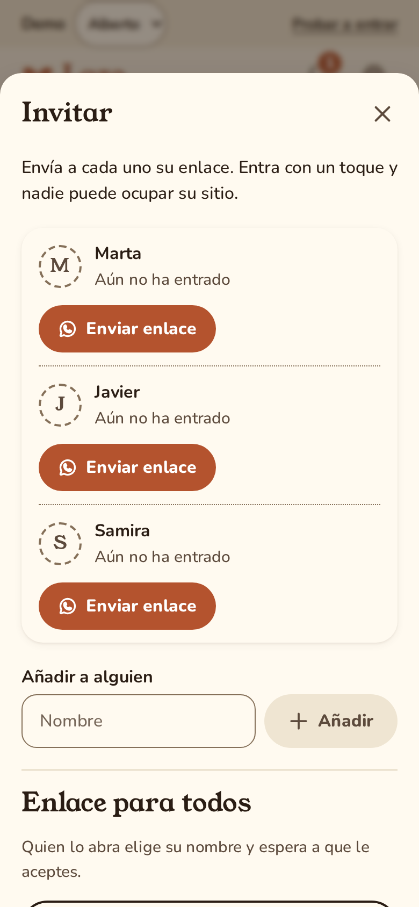

## 3. Entrar por el enlace

Sin contraseñas ni registros: abres el enlace que te ha llegado por WhatsApp y ya está.

- **Con tu enlace personal**, Lazo te saluda («Eres Marta») y solo tienes que tocar **«Entrar»**.
- **Con el enlace para todos**, ves **«¿Quién eres?»**, tocas tu nombre y Lazo te da un **código de 4 cifras**. Mándaselo a quien organiza con **«Mandar por WhatsApp»**: cuando lo compruebe y te acepte, la pantalla cambia sola y ya estás dentro.

  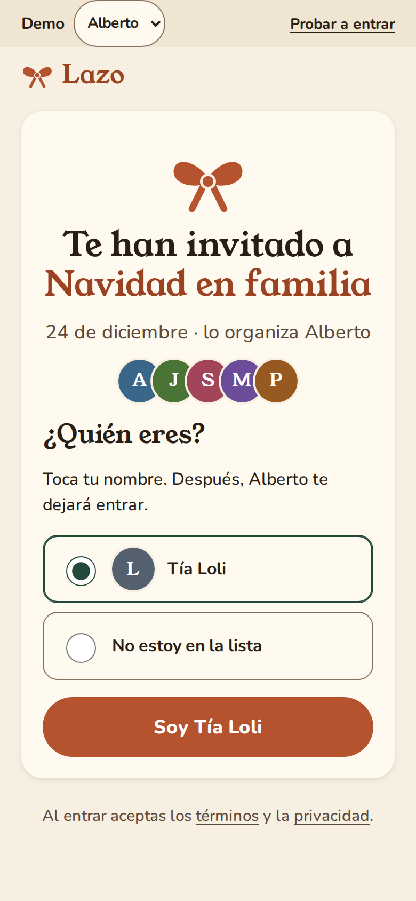
  &nbsp;
  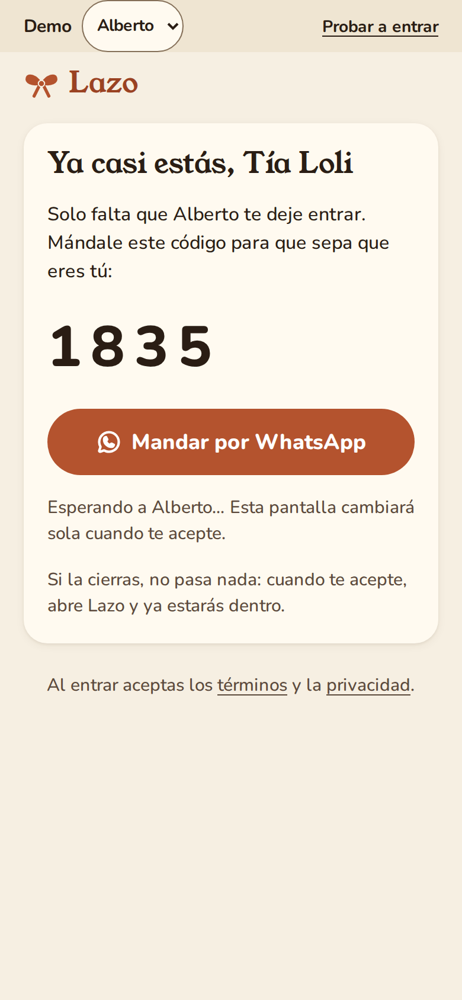

## 4. Añadir regalos

Desde tu lista, toca **«Añadir regalo»**. Tienes cuatro formas:

- **Pegando un enlace.** En la tienda, pulsa «Compartir» y «Copiar enlace». Vuelve a Lazo y toca **«Pegar enlace»**: Lazo rellena el nombre, la foto y el precio. Funciona con Amazon y con cualquier tienda. Después puedes decir **cuántas ganas** tienes («Me encantaría», «Me gustaría», «Si sobra») y añadir talla, color o notas.
- **Desde una lista de Amazon.** Toca **«Importar lista de Amazon»** y sigue los pasos para tu móvil: copias la página de tu lista de deseos y Lazo encuentra todos los productos. Los que ya tenías se quedan sin marcar para no repetirlos. En Android también puedes usar **«Compartir → Lazo»** desde el navegador.
- **Desde Excel.** Toca **«Importar desde Excel»** y elige tu archivo. Lazo adivina qué columna es el nombre, el precio o la tienda; si se equivoca, lo corriges antes de importar.
- **Escribiéndolo a mano.**

  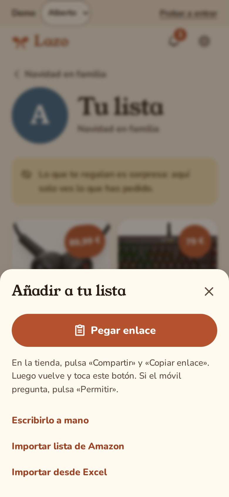
  &nbsp;
  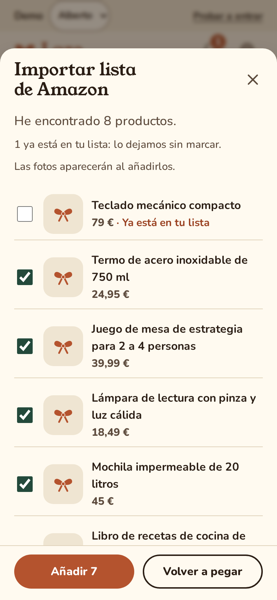

> Lazo no entra en Amazon por ti ni guarda tu cuenta: solo lee lo que tú copias.

## 5. Reservar, comprar y la hucha

Abre la lista de alguien. Arriba verás su **presupuesto** («Quedan 85 €») y debajo los regalos **Disponibles** y los **Ya cogidos**.

- **«Me lo reservo»**: un toque y nadie más lo comprará. Si te equivocas, **«Deshacer»**.
- **«Ya lo compré»** cuando lo tengas: Lazo te pregunta cuánto costó y de dónde sale el dinero.
- **«Para la hucha»**: el regalo se paga entre todos. En la pestaña **Hucha** ves **tu parte, persona a persona**, y apuntas lo que ya has dado. Lazo no mueve dinero: solo lo apunta. Dáselo en mano o por Bizum, como queráis.
- **«Poner dinero»**: para un regalo caro a medias, cada uno apunta lo que pone.
- En **Mis compras** tienes todo lo que has reservado o comprado y cuánto llevas gastado. Solo lo ves tú.

  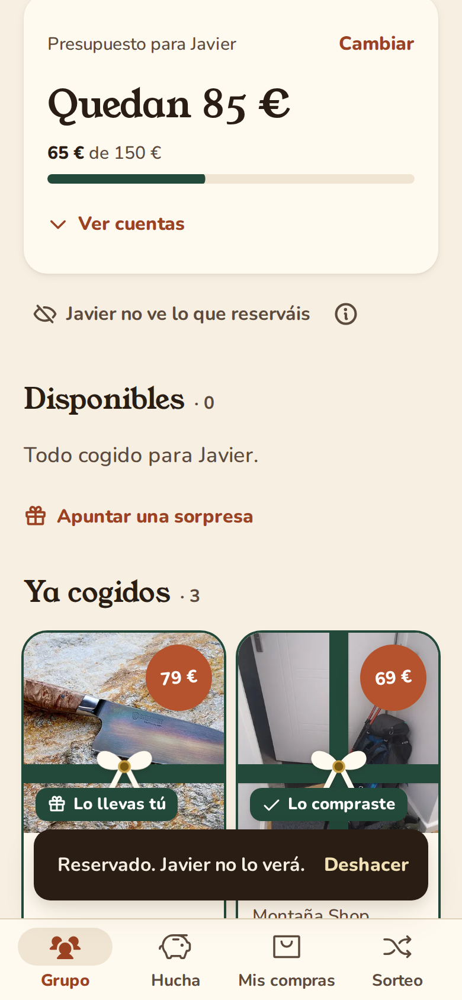
  &nbsp;
  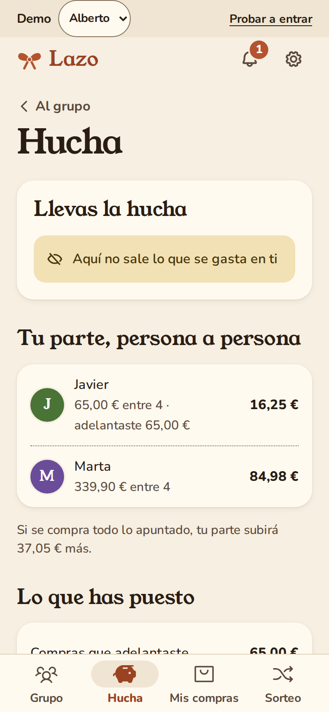

## 6. La regla de la sorpresa

Esto es lo más importante de Lazo. **Tú ves tu lista, pero no quién reserva, qué se ha comprado ni cuánto os gastáis.** Los demás sí lo ven. Y no es solo que no salga en la pantalla: tu móvil ni siquiera recibe esa información.

Aquí está la lista de Marta vista por Alberto y vista por la propia Marta:

<table>
  <tr>
    <th>Lo que ve Alberto</th>
    <th>Lo que ve Marta</th>
  </tr>
  <tr>
    <td>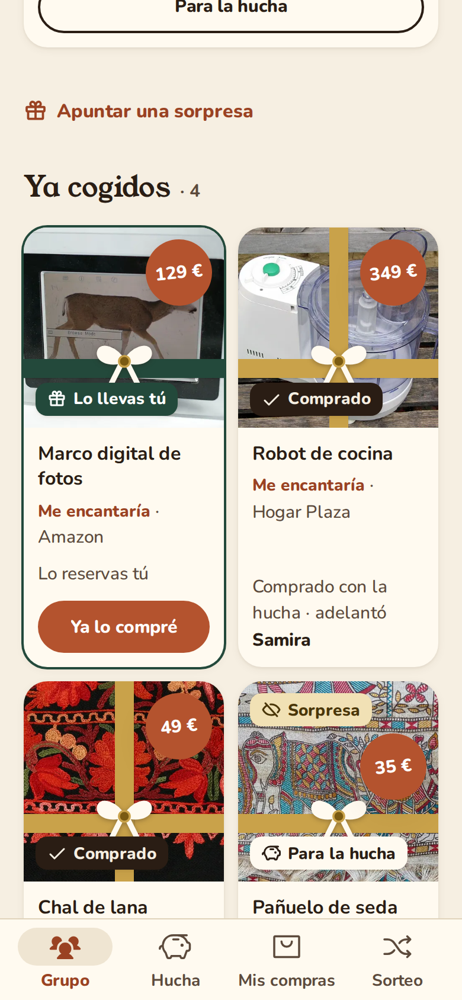</td>
    <td>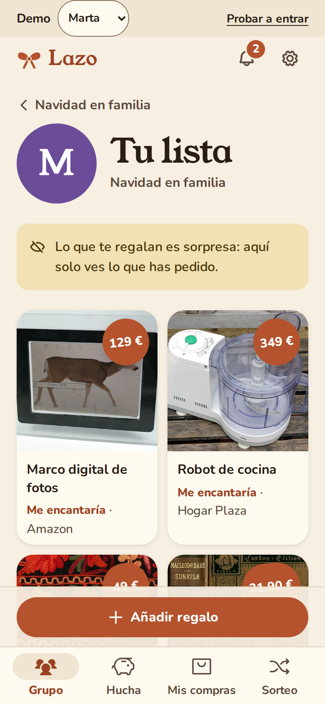</td>
  </tr>
</table>

Lo mismo pasa con el presupuesto, la hucha y los avisos de la campana: nunca te cuentan nada de tu propia lista.

## 7. El amigo invisible

En **Sorteo**, quien organiza el grupo toca **«Preparar el sorteo»**, elige **quién participa**, **quién no puede tocarse** (por ejemplo, las parejas, que ya se regalan entre ellas) y un **presupuesto por regalo**.

Cada uno recibe un paquete cerrado. **«Abrir el paquete»** (mira que nadie te esté mirando) y verás a quién te toca regalar y un botón para ir a su lista. Solo tú sabes a quién regalas: ni quien organiza ve el resto.

  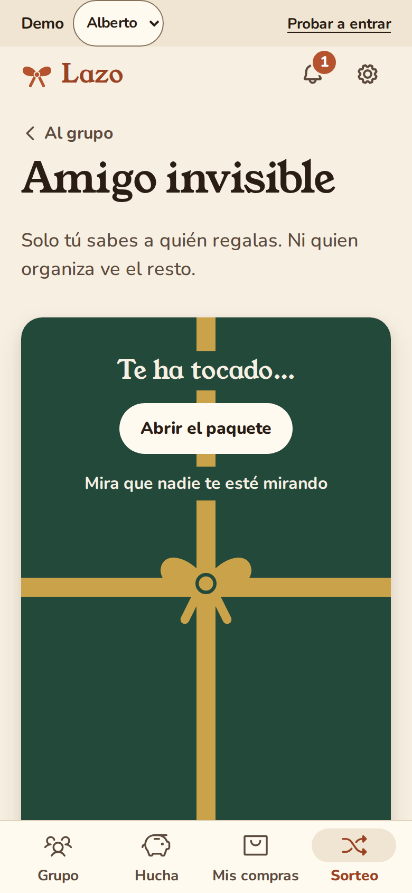
  &nbsp;
  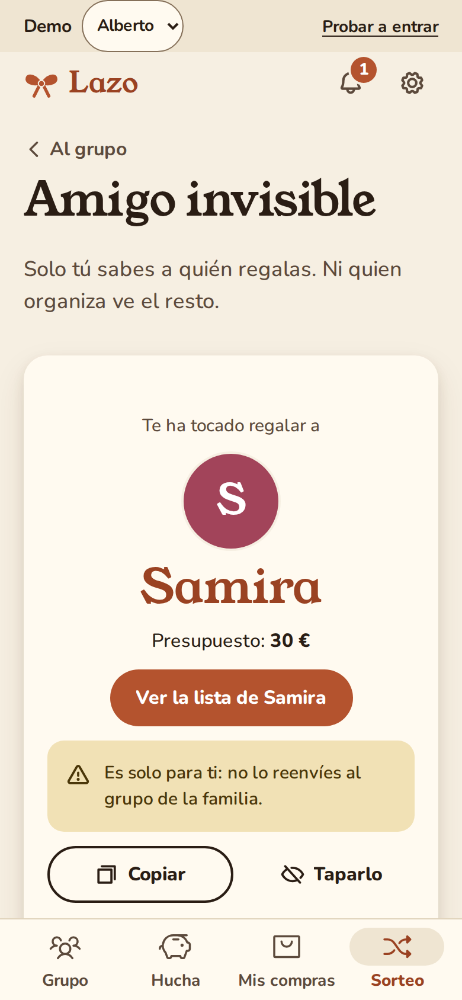

## 8. El día de la entrega

Cuando ya ha pasado la fecha, quien organiza puede **«Proponer abrirla»**. En cuanto otra persona dice **«De acuerdo»**, la entrega queda abierta y cada uno puede tocar **«Ver qué me regalaron»**: los regalos y de parte de quién. **No se enseñan precios ni cuentas.** Y si prefieres quedarte con la sorpresa, no tienes por qué mirarlo.

  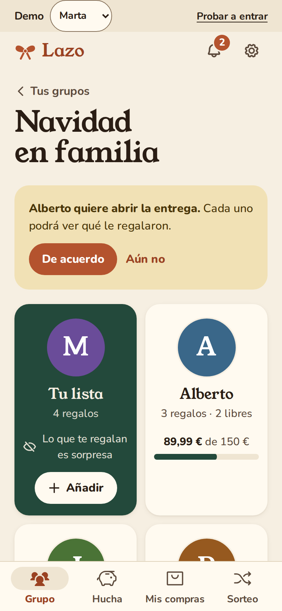
  &nbsp;
  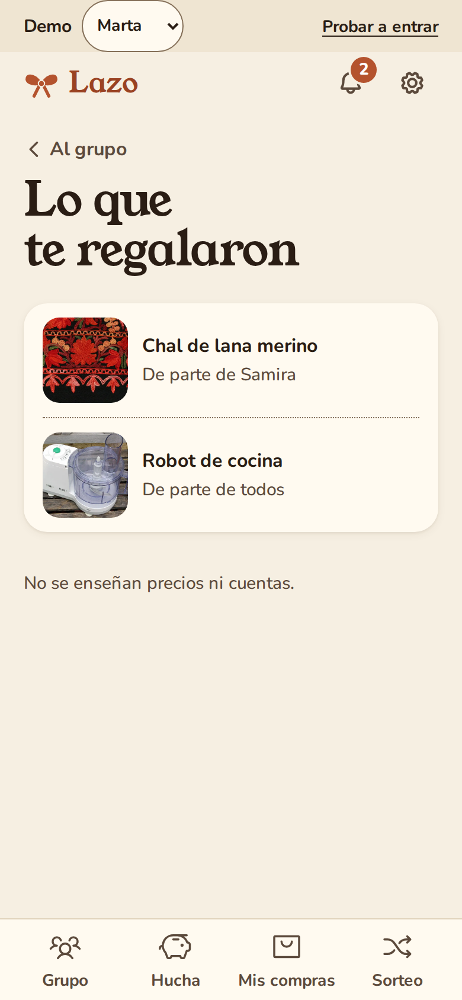

## 9. Imprimir y compartir tu lista

- **«Imprimir la lista»**: una hoja bonita con fotos, precios orientativos y un código QR por regalo para verlo en la tienda con la cámara del móvil. No dice qué está cogido. Sirve también para **guardarla en PDF**.
- **«Compartir mi lista (solo lectura)»**: un enlace para quien no está en el grupo (la madrina, un compañero de trabajo…). Verá tus regalos con foto, precio y enlace a la tienda; nunca qué está cogido ni las sorpresas. Si creas otro enlace, el anterior deja de funcionar, y con **«Dejar de compartir»** lo apagas.

  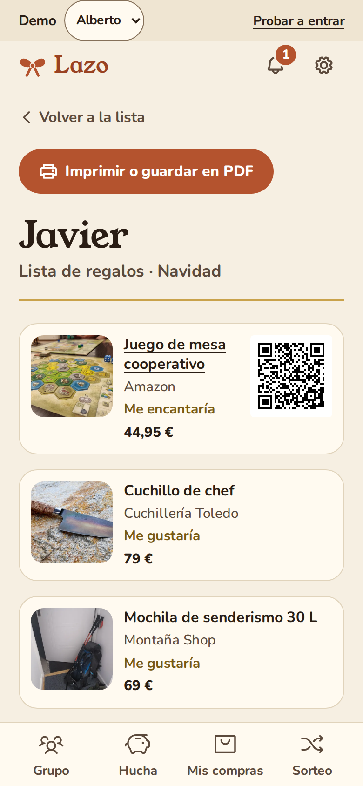
  &nbsp;
  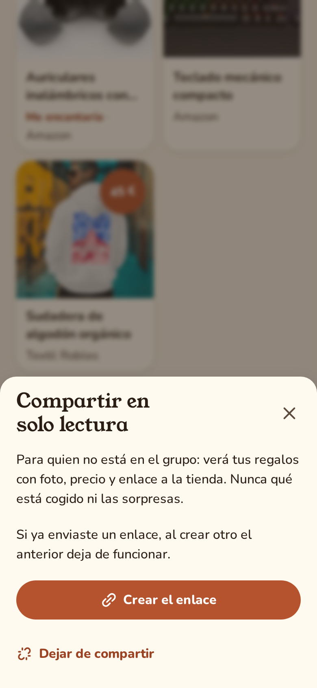

## Preguntas frecuentes

### ¿Quién ve mis datos?

Tu familia y nadie más. Las listas viven en el servidor de tu casa, o en el de quien organiza tu familia: Lazo no es una empresa y no hay nadie detrás mirando. Para los niños solo se guarda el nombre de pila y, si quieres, el año en que nacieron. Al pegar un enlace, Lazo solo lee los datos que la tienda publica para compartir (los mismos que usa WhatsApp para la vista previa).

### ¿Cuánto cuesta?

Nada. Ni cuotas ni anuncios. Lo único que necesitáis es un pequeño ordenador en casa (una Raspberry Pi vale) para que la familia comparta las listas: [así se monta](docs/PRUEBA-REAL.md). Si alguien quiere usar la inteligencia artificial opcional con un servicio de pago, eso lo paga con su propia clave; Lazo funciona entero sin ella.

### ¿Funciona sin internet?

Sin conexión verás lo último que cargaste, con una franja que dice «Sin conexión». Para reservar, añadir o ver lo último de los demás hace falta conexión; cuando vuelve, la pantalla se pone al día sola.

### ¿Qué pasa si pierdo el móvil?

No pierdes nada. Pide a quien organiza el grupo que, en **Invitar → «Si alguien pierde el móvil»**, toque **«Ha perdido el móvil»**: se cierra tu sesión en el móvil perdido, tu lista y todo lo tuyo se quedan como estaban, y te llega un enlace nuevo. Si tienes otro móvil o una tableta con Lazo abierto, en **Ajustes** puedes **«Cerrar sesión en todos los móviles»** o usar **«Entrar en otro móvil»** con un código.

### ¿Los niños necesitan cuenta?

No. Quien organiza crea la **lista de un niño** desde **Invitar** con su nombre de pila y, si quiere, el año en que nació. La llevan sus padres, que pueden añadir regalos y ven lo reservado para coordinarse con el resto de mayores.

### ¿Lazo compra por mí?

No. Lazo no compra, no paga y no mueve dinero: solo apunta quién regala qué y cuánto pone cada uno. Las compras las haces tú en la tienda de siempre, y el dinero de la hucha os lo dais en mano o por Bizum.

### ¿Y si alguien quiere regalarme algo que no está en mi lista?

Puede **«Apuntar una sorpresa»** en tu lista. Los demás la ven para no repetir; tú no.

### ¿Cómo lo instalo en el móvil?

En Android, descarga la app desde [la última versión](https://github.com/BertMarti/lazo/releases/latest). En cualquier móvil (también iPhone), abre tu Lazo en el navegador y pulsa **«Añadir a pantalla de inicio»**.

Al abrir la app por primera vez eliges cómo empezar: **«Me han invitado»** (pegas el enlace de WhatsApp), **«Tengo un código»** (la dirección de tu Lazo y un código de 8 letras) o **«Quiero organizar un grupo»** (cómo montarlo en casa).

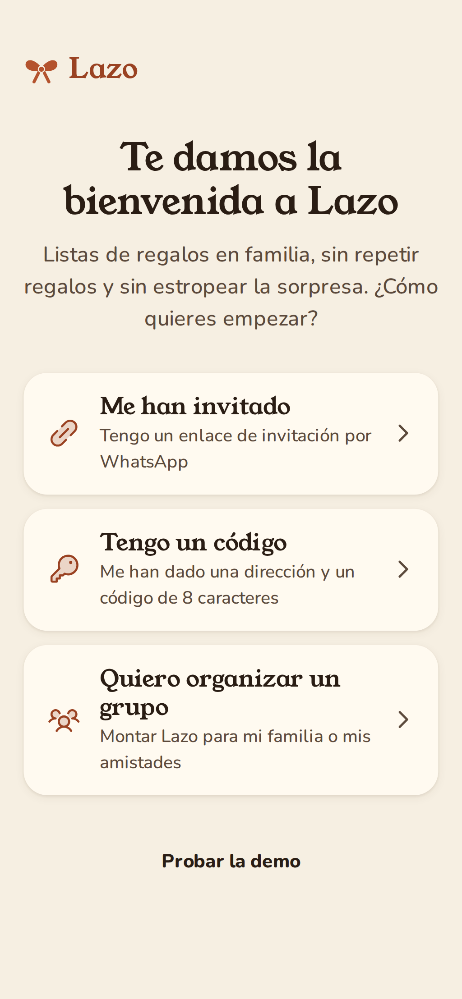

## Privacidad y legal

En lenguaje llano:

- [Privacidad](docs/legal/PRIVACIDAD.md)
- [Datos de los niños](docs/legal/MENORES.md)
- [Términos de uso](docs/legal/TERMINOS.md)
- [Listas de Amazon](docs/legal/AMAZON.md)
- [Servicios de inteligencia artificial](docs/legal/proveedores.md)

---

¿Quieres saber cómo está hecho, montarlo tú o colaborar? Todo lo técnico está en **[docs/DESARROLLO.md](docs/DESARROLLO.md)**. Las novedades de cada versión, en el [CHANGELOG](CHANGELOG.md).

Hecho con cariño para las familias que se lían con los regalos. Licencia <a href="LICENSE">MIT</a>.

